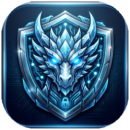

[🇺🇸 English](../../README.md) &nbsp;/&nbsp; **🇮🇷 فارسی**

 

<h1 align="center">IceDragon VPN</h1>

<h2 align="center" dir="rtl">⚠️ پروژه مستقل و غیررسمی</h2>

<h3 align="center" dir="rtl">&rlm;IceDragon VPN یک کلاینت اختصاصی اندروید با طراحی Dark Glass است که بر پایه هسته متن‌باز <a href="https://github.com/armanlife/arman-vpn-client">Arman VPN</a> ساخته شده است و هیچ ارتباطی با موزیلا ندارد.</h3>

## &rlm;IceDragon VPN چیست؟

&rlm;**IceDragon VPN** یک VPN رایگان و متن‌باز برای اندروید است که با حساب فایرفاکس (Firefox Account) کار می‌کند و ترافیک شما را از سرورهای موزیلا روی زیرساخت **Fastly** با تونل‌های امن **HTTP/1.1، HTTP/2 و HTTP/3** عبور می‌دهد.

## 📥 دانلود مستقیم

<table>
<thead align="right">
<tr><th>سیستم‌عامل</th><th>دانلود</th></tr>
</thead>
<tbody align="right">
<tr><td>اندروید</td><td>   </td></tr>
<tr><td>اندروید TV</td><td></td></tr>
</tbody>
</table>

**کدام فایل را دانلود کنم؟**

- **ARMv8 (`arm64-v8a`):** برای بیشتر گوشی‌های امروزی مناسب است و حجم کمتری دارد.
- **Universal:** روی همه گوشی‌ها و تلویزیون‌های اندرویدی نصب می‌شود.

## 🚀 امکانات اصلی

- 🐉 **رابط کاربری Dark Glassmorphism:** صفحه خانه ساده و مدرن با دکمه اتصال لومینوس، نمودار زنده سرعت، تایمر نشست و انتخاب سریع کشورها
- ⭐ **کشورهای محبوب و اتصال سریع‌ترین:** پین کردن کشورهای دلخواه روی صفحه اول + تست پینگ و اتصال یک‌لمسی به سریع‌ترین سرور
- 🩺 **پزشک اتصال هوشمند:** تشخیص فیلترینگ DNS و آزمایش خودکار ترکیب‌های دور زدن فیلترینگ (`H2+SNI`، `H3`، `H2+Record`، `H1+First-Byte`)
- 🆓 **رایگان (۵۰ گیگابایت برای هر حساب فایرفاکس):** پشتیبانی از چند حساب با تعویض خودکار
- 🔀 **مسیریابی هوشمند (Split Tunneling):** مستثنی کردن سایت‌ها و اپلیکیشن‌های داخلی ایران
- 🔄 **به‌روزرسانی درون‌برنامه‌ای:** بررسی خودکار نسخه جدید و دانلود APK متناسب با پردازنده گوشی از بخش **تنظیمات ← درباره برنامه**

