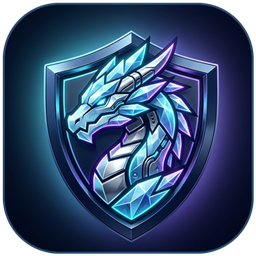

<h1 align="center">IceDragon VPN</h1>

<h3 align="center">Быстрый, зашифрованный Android VPN с открытым исходным кодом в стиле Dark Glass</h3>

[📥 Скачать APK](#-быстрая-загрузка) &bull; [💬 Telegram-канал](https://t.me/icedragon_lair) &bull; [English](../../README.md) &bull; [فارسی](README_fa.md) &bull; [中文](README_zh.md)

---

## ✨ Возможности IceDragon VPN

**IceDragon VPN** — быстрый, бесплатный и открытый Android VPN для стабильной связи, высокой скорости и надёжной защиты трафика. Туннелирование **HTTP/2 и HTTP/3**, интеллектуальное переключение между аккаунтами и стильный интерфейс **Dark Glass** обеспечивают мгновенное подключение в одно касание.

- 🧊 **Интерфейс Dark Glass:** тёмный экран запуска без белой вспышки, фирменная иконка ледяного дракона и виджет рабочего стола.
- 🚀 **HTTP/2 и HTTP/3 туннели:** низкая задержка и стабильная работа в сложных сетях.
- 🔄 **50 ГБ/мес на аккаунт и авто-переключение:** плавная смена аккаунта при достижении лимита без разрыва соединений.
- ⚡ **Живой пинг на быстрых локациях и диагностика в 1 касание:** Auto-Fix & Connect и цветовые метки задержки.
- 🔔 **Удобные уведомления об обновлениях:** мягкое оповещение о выходе новой версии прямо в приложении.

## 📥 Быстрая загрузка

<table>
  <tr><th>Версия</th><th>Для кого</th><th>Скачать</th></tr>
  <tr><td><strong>Android ARM64 (<code>arm64-v8a</code>)</strong></td><td>Современные Android-смартфоны (рекомендуется)</td><td><a href="https://github.com/amirwoolyt-maker/icedragon-vpn/releases/latest/download/IceDragon-VPN-Android-arm64-v8a.apk">IceDragon-VPN-Android-arm64-v8a.apk</a></td></tr>
  <tr><td><strong>Android Universal</strong></td><td>Любые Android-устройства и Android TV</td><td><a href="https://github.com/amirwoolyt-maker/icedragon-vpn/releases/latest/download/IceDragon-VPN-Android-universal.apk">IceDragon-VPN-Android-universal.apk</a></td></tr>
  <tr><td><strong>Android ARMv7 (<code>armeabi-v7a</code>)</strong></td><td>Старые 32-битные устройства</td><td><a href="https://github.com/amirwoolyt-maker/icedragon-vpn/releases/latest/download/IceDragon-VPN-Android-armeabi-v7a.apk">IceDragon-VPN-Android-armeabi-v7a.apk</a></td></tr>
  <tr><td><strong>Android x86_64</strong></td><td>x86_64 планшеты и эмуляторы</td><td><a href="https://github.com/amirwoolyt-maker/icedragon-vpn/releases/latest/download/IceDragon-VPN-Android-x86_64.apk">IceDragon-VPN-Android-x86_64.apk</a></td></tr>
</table>

## 💬 Telegram-канал

Новости, релизы и поддержка: **[t.me/icedragon_lair](https://t.me/icedragon_lair)** (`@icedragon_lair`)

## 📄 Лицензия

[GNU General Public License v3.0](../../LICENSE).
