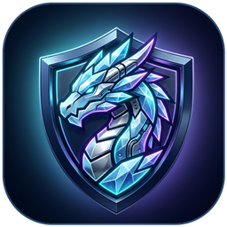

<h1 align="center">IceDragon VPN</h1>

<h3 align="center">快速、安全的开源 Dark Glass 风格 Android VPN</h3>

[📥 下载 APK](#-快速下载) &bull; [💬 Telegram 频道](https://t.me/icedragon_lair) &bull; [English](../../README.md) &bull; [فارسی](README_fa.md) &bull; [Русский](README_ru.md)

---

## ✨ 为什么选择 IceDragon VPN？

**IceDragon VPN** 是一款快速、免费、开源的 Android VPN，专为高稳定性、低延迟与隐私保护而打造。基于 **HTTP/2 与 HTTP/3** 加密隧道、智能多账户切换和精致的 **Dark Glass** 暗夜玻璃界面，一键即可流畅连接。

- 🧊 **Dark Glass 暗夜玻璃视觉：** 零白屏启动画面、冰龙盾徽图标与精致桌面小组件。
- 🚀 **HTTP/2 & HTTP/3 加密隧道：** 应对复杂网络环境，兼顾高带宽与低延迟。
- 🔄 **每账户每月 50 GB & 自动无感切换：** 达到配额阈值后自动切换账户，不中断当前连接。
- ⚡ **实时延迟测速与一键自愈诊断：** 主页常用节点显示实时延迟（`ms`），内置 Auto-Fix & Connect 一键修复连接。
- 🔔 **无打扰应用内更新提醒：** 新版本发布时自动提示升级，同时保持旧版本稳定运行。

## 📥 快速下载

<table>
  <tr><th>版本</th><th>适用设备</th><th>下载链接</th></tr>
  <tr><td><strong>Android ARM64 (<code>arm64-v8a</code>)</strong></td><td>主流现代 Android 手机与平板（推荐）</td><td><a href="https://github.com/amirwoolyt-maker/icedragon-vpn/releases/latest/download/IceDragon-VPN-Android-arm64-v8a.apk">IceDragon-VPN-Android-arm64-v8a.apk</a></td></tr>
  <tr><td><strong>Android Universal</strong></td><td>所有 Android 手机与 Android TV</td><td><a href="https://github.com/amirwoolyt-maker/icedragon-vpn/releases/latest/download/IceDragon-VPN-Android-universal.apk">IceDragon-VPN-Android-universal.apk</a></td></tr>
  <tr><td><strong>Android ARMv7 (<code>armeabi-v7a</code>)</strong></td><td>较旧的 32 位 Android 设备</td><td><a href="https://github.com/amirwoolyt-maker/icedragon-vpn/releases/latest/download/IceDragon-VPN-Android-armeabi-v7a.apk">IceDragon-VPN-Android-armeabi-v7a.apk</a></td></tr>
  <tr><td><strong>Android x86_64</strong></td><td>x86_64 架构设备与模拟器</td><td><a href="https://github.com/amirwoolyt-maker/icedragon-vpn/releases/latest/download/IceDragon-VPN-Android-x86_64.apk">IceDragon-VPN-Android-x86_64.apk</a></td></tr>
</table>

## 💬 Telegram 频道

获取最新版本通知与技术支持：**[t.me/icedragon_lair](https://t.me/icedragon_lair)**（`@icedragon_lair`）

## 📄 开源许可

基于 [GNU General Public License v3.0](../../LICENSE) 发布。
